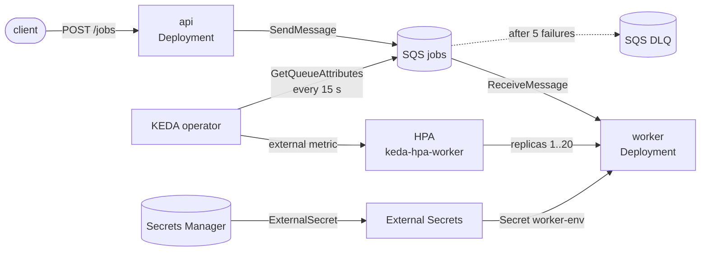

# terraform-aws-eks-queue-platform

[](../../actions/workflows/validate.yml)

Terraform modules for running an HTTP service and SQS queue workers on EKS,
with the workers scaled by **KEDA on queue backlog** instead of a standard
**HPA on CPU**.

The repo exists to show that decision and the reasoning behind it. The full
argument is in [ADR 2](docs/decisions/0002-scale-queue-workers-with-keda.md);
the short version is below.

## Why KEDA instead of HPA

Queue workers are I/O-bound: they spend most of their time waiting on
downstream APIs and databases. That breaks CPU-based autoscaling in two ways.

| | HPA on CPU | HPA on CloudWatch SQS metric | **KEDA `aws-sqs-queue`** |
|---|---|---|---|
| Scaling signal | CPU % | Queue depth | Queue depth (visible + in-flight) |
| Rule | Keep CPU at X% | N messages per pod | **N messages per pod** |
| Signal freshness | ~15 s | 1-min metrics, minutes of delay | **~15 s, read straight from SQS** |
| Reacts to a burst of I/O-bound jobs | Often not at all | Late | **Within one polling interval** |
| Extra components | none | metrics adapter (+ exporter) | KEDA operator + metrics server |

1. **Backlog per pod is the rule we actually want.** "One pod per 20 waiting
   messages" maps directly to how long a job waits. CPU doesn't: during a
   burst, pods sit at 20% CPU waiting on the network while the queue grows.
2. **Bursts need a fresh signal.** KEDA calls `GetQueueAttributes` every 15 s.
   SQS's CloudWatch metrics, which a plain HPA would have to go through, are
   one-minute data points that arrive minutes late.

KEDA doesn't replace the HPA: it creates one (`keda-hpa-<name>`) and feeds it
the queue depth as an external metric. The HPA still does the replica math and
applies the `behavior` policies set here.

With the defaults, a burst of 500 messages takes the worker from 1 to 20 pods
in about 45 seconds (+max(4 pods, 100%) every 15 s), and it scales back down
by at most half per minute after 5 quiet minutes.

## Architecture



Every pod that calls AWS has its own IAM role through IRSA. KEDA's role can
only read the depth of queues that have a `ScaledObject`; it can't read
messages.

## Repository layout

```
modules/
  cluster/            EKS control plane (KMS-encrypted secrets, API auth mode),
                      managed node group (AL2023), OIDC provider, core add-ons
  addons/             KEDA and External Secrets Operator (Helm), KEDA's IRSA role
  workload/           Deployment, ServiceAccount + IRSA role, optional Service,
                      SecretStore + ExternalSecret for Secrets Manager values
  queue-autoscaler/   KEDA TriggerAuthentication + ScaledObject on SQS depth,
                      grants KEDA read access to that one queue
examples/
  complete/           VPC, cluster, add-ons, SQS + DLQ, an HTTP service (producer)
                      and a queue worker (consumer) with sample Python apps
docs/decisions/       Architecture Decision Records
.github/workflows/    validate.yml: fmt, validate, tflint, checkov, ruff
```

`addons` is split from `cluster` so that cluster creation (AWS provider only)
and in-cluster installs (Helm) stay apart.

## Usage

```hcl
module "worker" {
  source = "./modules/workload"

  name       = "worker"
  namespace  = "jobs"
  image      = "ghcr.io/you/worker:1.0.0"
  aws_region = "eu-central-1"

  termination_grace_period_seconds = 60
  env          = { QUEUE_URL = aws_sqs_queue.jobs.url }
  iam_policies = { "sqs-consume" = data.aws_iam_policy_document.consume.json }

  secrets     = { DOWNSTREAM_API_TOKEN = { remote_key = "app/worker/api", property = "token" } }
  secret_arns = [aws_secretsmanager_secret.api.arn]

  oidc_provider_arn = module.cluster.oidc_provider_arn
  oidc_issuer       = module.cluster.oidc_issuer
}

module "worker_autoscaler" {
  source = "./modules/queue-autoscaler"

  deployment_name         = module.worker.deployment_name
  namespace               = "jobs"
  queue_url               = aws_sqs_queue.jobs.url
  queue_arn               = aws_sqs_queue.jobs.arn
  aws_region              = "eu-central-1"
  keda_operator_role_name = module.addons.keda_operator_role_name

  messages_per_pod = 20 # what one pod clears within your latency target
  min_replicas     = 1  # 0 = scale to zero, at the cost of cold starts
  max_replicas     = 20 # also protects downstream systems
}
```

See [examples/complete](examples/complete) for the full wiring.

### Choosing `messages_per_pod`

`desired replicas = ceil((visible + in-flight messages) / messages_per_pod)`

Pick the number of messages one pod can clear within the time a job is allowed
to wait. A pod that handles 2 msg/s with a 10 s target gets `20`. Lower means
more pods sooner; higher means fewer pods and longer waits.

### Worker requirements

Autoscaling a consumer means pods are removed while they hold messages. The
sample worker ([app/worker/worker.py](examples/complete/app/worker/worker.py))
shows what every worker needs:

- stop receiving on SIGTERM and finish the current message within
  `terminationGracePeriodSeconds`;
- delete a message only after it is processed, and be idempotent, since an
  unfinished message comes back after the visibility timeout;
- a visibility timeout longer than the maximum processing time (the example
  uses 2×), and a dead-letter queue for messages that keep failing.

## Validation

This repo is checked in CI and has not been applied as-is to an AWS account.

```sh
terraform fmt -check -recursive
for d in modules/* examples/complete; do (cd $d && terraform init -backend=false && terraform validate); done
tflint --init && tflint --recursive --config "$PWD/.tflint.hcl"
checkov -d . --framework terraform github_actions dockerfile --compact --quiet
```

### Accepted security findings

Checkov runs in CI and fails on any finding. Twenty findings are accepted on
purpose, each skipped inline with its reason (`grep -rn checkov:skip .`).
Three that are design choices rather than exceptions:

- **No CPU limits** (`CKV_K8S_11`). Pods get a CPU *request*, which guarantees
  their share, but no limit. A limit means CFS throttling, which shows up as
  latency exactly when a burst arrives. Memory has a limit, because running out
  of memory can't be throttled.
- **`imagePullPolicy` is not `Always`** (`CKV_K8S_15`). `Always` adds a
  registry round-trip to every pod start, and in this repo every scale-up is a
  burst of pod starts. Immutable tags or digests give the same guarantee
  without the delay.
- **KMS key policy grants `kms:*` on `*` to the account root** (`CKV_AWS_109`,
  `CKV_AWS_111`, `CKV_AWS_356`). The scanner reads it as an IAM policy. In a
  key policy, `Resource: "*"` means this key, and the root principal delegates
  access to IAM policies in the account: the AWS default, written out
  explicitly.

To try the example (creates billable resources: EKS control plane, NAT
gateway, two m6i.large nodes):

```sh
cd examples/complete
cp terraform.tfvars.example terraform.tfvars   # set images and your IP
terraform init && terraform apply
$(terraform output -raw kubeconfig_command)
kubectl -n jobs get hpa keda-hpa-worker -w     # then send messages to the queue
terraform destroy
```

## How this was built

The code and docs were generated with an AI coding assistant (Claude Code)
from a written spec: the module layout, the decision to document, and the
constraints. Then I reviewed every file. Generated infrastructure usually
looks right and validates. What I check is what `terraform validate` can't
catch:

- **Versions against the registries, not memory.** Every provider, Helm
  chart, module and GitHub Action version was looked up, as was the list of
  EKS versions in standard support.
- **Things that only fail at plan or apply.** `count`/`for_each` over values
  unknown at plan time (so `iam_policies` is a map with static keys);
  Terraform and KEDA both owning `replicas` (Terraform now ignores it);
  custom resources through `kubernetes_manifest`, which needs the CRDs to
  exist at plan time (replaced with `kubectl_manifest`).
- **Who can do what.** One IAM role per identity, and what each one can reach.
  KEDA reads the depth of its own queues and nothing else; the External
  Secrets controller has no AWS permissions at all.
- **Failure paths.** What happens to a message when its pod is scaled away,
  and whether the visibility timeout, processing time and grace period fit
  together.
- **Every number in the docs, recomputed.**
- **Scanner output, finding by finding.** Fix it or write down why not.

Rejected or changed during review:

- The worker received **batches of 10**. A batch of slow messages would
  outlive both the visibility timeout and the shutdown grace period, so
  another pod would process them twice. It now takes one message at a time by
  default, and the batch size is a documented trade-off.
- The **API endpoint was public to `0.0.0.0/0` by default**. Now it's private
  by default, and the example refuses to plan without your own CIDR.
- **Control-plane logging** covered 3 of 5 log types. Now all five (found by
  checkov).
- **KEDA using the worker's IAM role** (`identityOwner: workload`) would have
  given the worker's role a second job. Now KEDA has its own role, which can
  only read queue depth.
- **The API-call cost** in ADR 2 first counted only KEDA's polling. The HPA
  queries the metric on its own interval too, which doubles it, to about
  350k calls a month per queue.
- **Scale to zero by default.** It looks good in a demo, but the first job
  after a quiet period would wait for a cold start. Off by default, a switch
  per worker.

## Not included

- **Node autoscaling** (Cluster Autoscaler or Karpenter). KEDA adds pods; in a
  real cluster something has to add nodes for them.
- Ingress / AWS Load Balancer Controller for the HTTP service.
- Image builds and deployment pipelines for the apps.
- Monitoring and alerting (queue age, DLQ depth, KEDA errors).

## Decisions

1. [Record architecture decisions](docs/decisions/0001-record-architecture-decisions.md)
2. [Scale queue workers with KEDA on SQS backlog, not HPA on CPU](docs/decisions/0002-scale-queue-workers-with-keda.md)
3. [Give pods AWS access with IRSA, one role per service account](docs/decisions/0003-irsa-for-pod-aws-access.md)
4. [Deliver secrets with External Secrets Operator](docs/decisions/0004-external-secrets-for-app-config.md)

## License

Apache License 2.0, see [LICENSE](LICENSE).
